# beamLED

A standalone LED ceiling renderer on a WT32-ETH01 (ESP32). It draws big, bold effects for a ceiling
of LED bars, from a slow drift of colour to beams and bars that snap and sweep on every beat, and
sends them as Art-Net to a pixel controller. There is no PC in the
chain: the board steps through presets on a single button or by itself, locks to the beat of
Ableton Live over Ableton Link, and takes live control over OSC (made for
[MIMa](https://beatline.xyz)).

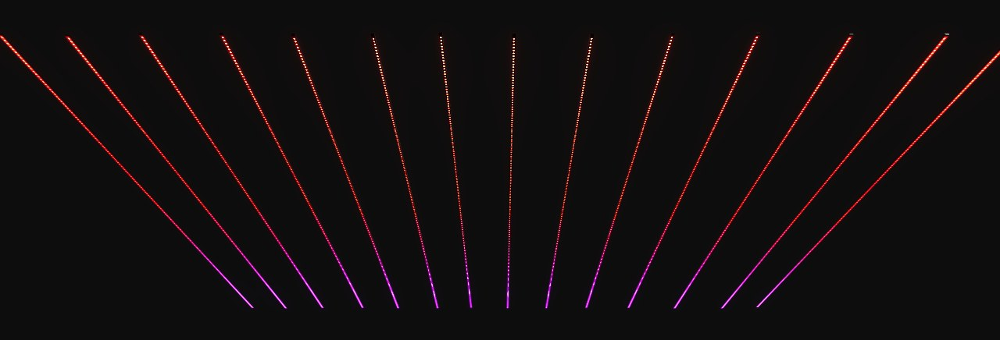

*All the pictures of the ceiling here are the board's real Art-Net output, shown in
[Beam](https://beatline.xyz/beam), the Beatline visualiser.*

## Why

The ceiling it was made for has 15 LED bars of 180 RGB pixels, 5 m long, hung parallel 0.46 to
0.65 m apart. General-purpose LED firmware treats that as a dense 180 x 15 image. Because the bars
are far apart compared with the LEDs along them, effects designed for a dense grid look busy,
flicker as fine detail crosses a bar, and are distorted by the uneven spacing. beamLED was written
for this kind of installation (see [docs/background.md](docs/background.md)):

- Every effect is evaluated at the real position of each LED. Nothing is drawn in the empty space
  between the bars. Sizes and speeds are set as a share of the ceiling's shorter side, so a preset
  keeps its look on a bigger or smaller ceiling, or on a small test rig.
- Detail across the bars is kept soft (features of 0.8 m and more), and where an edge crosses a bar
  it is widened by the bar's share of the gap, so it moves across the ceiling smoothly.
- Effects are made of big shapes (wide bands, beams, clouds, rings, gradients), not pixel detail.
  They can drift for hours as background light, or run fast and land on every beat for a show.

## Features

- **13 effects**, each with its own sliders and a palette: Rolling bars, Searchlights, Lighthouse,
  Clouds, Sparkle, Sweeps, Plaid, Rings, Drops, Interference, Gradient, Shapes and Strobe, plus one sparkle
  overlay over whichever plays (it stays on when the preset changes): white or in palette colours
  (random, or stepping along the palette twinkle by twinkle), twinkling freely or starting on
  quarter, eighth, sixteenth or 32nd notes, as single twinkles or in bursts.
- **Palette lock**: every preset plays one chosen palette instead of its own, for a show in one
  set of colours; off again, each preset has its own (the lock isn't saved).
- **Auto**: the presets change by themselves every so many seconds, or every so many bars on the
  beat, in order or shuffled, among the presets you choose.
- **Presets**: up to 32, each an effect with its settings and a palette. The button on the board
  steps through them (short press: next and Auto off, double press: Auto on, long press:
  on/off); the one playing survives a power cut.
  Edits play at once and are kept with **Save**, or dropped with **Revert**. Rename a saved preset\n  and Save, and it becomes a new preset.
- **Mirror** per preset: the right half of the ceiling mirrors the left, along the rows; only the
  left half is rendered, so it takes about half the time.
- **Motions**: up to three per preset, each moving one slider back and forth by itself (a beam
  swinging, bands scrolling to and fro, a width breathing) along a shape, in seconds or in beats.
- **Palettes**: up to 16, of 2 to 5 colours, shared by the presets. Each colour has a position\n  along the palette: drag its marker to bunch colours together or give one a long blend.
- **Ableton Link**: tempo and beat shared with Ableton Live and other Link apps. Per preset, an
  effect can run in time, follow the tempo, or run in beats (one band, revolution or ring per 1 to
  64 beats, landing on the bar), with an optional brightness pulse on the beat.
- **OSC and OSCQuery**: every preset, slider, motion and palette colour has an OSC address, with its
  type, range and help, and changes are pushed back as feedback. Made for MIMa.
- **A web page** on the board: presets, sliders, motions, palettes, layout and network settings,
  with help on every control. It follows changes made anywhere (the button, OSC, another device)
  as they happen, without polling.
- **Network** over Ethernet only: DHCP, a fallback address, `http://beamled.local`, and firmware
  updates over the network. A WiFi hotspot for setting up comes on only in config mode.
- **Any layout** up to 64 rows and 6144 LEDs, with a start universe per row.

## Effects

| | |
|---|---|
| 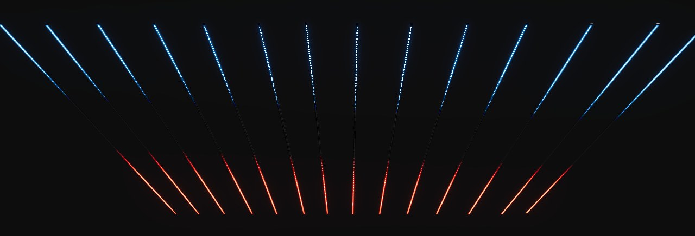 **Rolling bars**: wide soft bands rolling across the ceiling at any angle (a Motion on Angle swings it). | 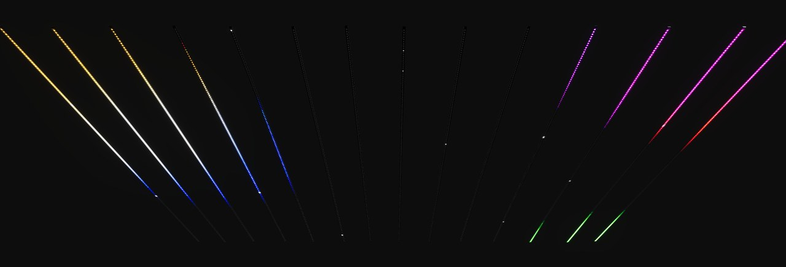 **Searchlights**: soft round beams wandering over the ceiling on slow looping paths. |
| 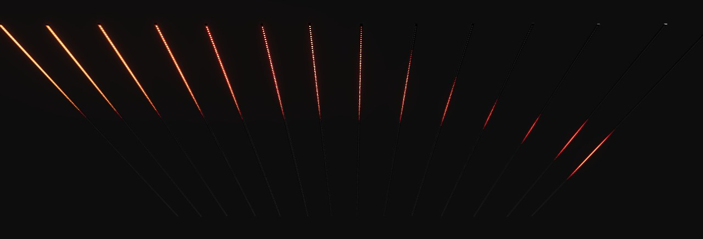 **Lighthouse**: a beam turning around a point at the edge of the ceiling or beyond it; it can also be aimed, or swung with a Motion. | 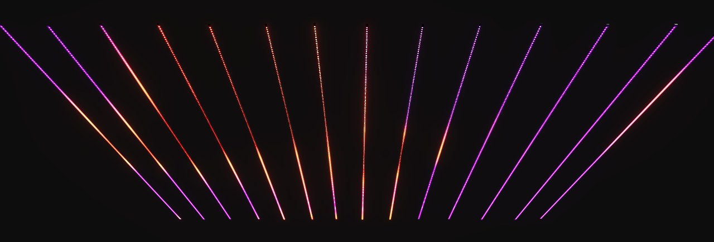 **Clouds**: soft clouds drifting on a slowly turning wind, from clear sky to overcast. |
| 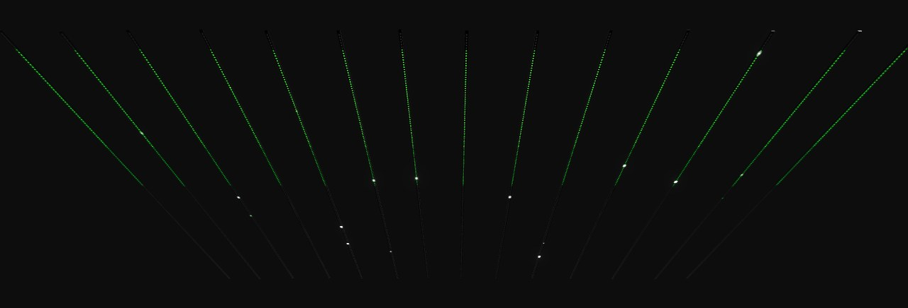 **Sweeps**: bars sweeping across the ceiling one after another, each pass at a new angle, with a trail. | 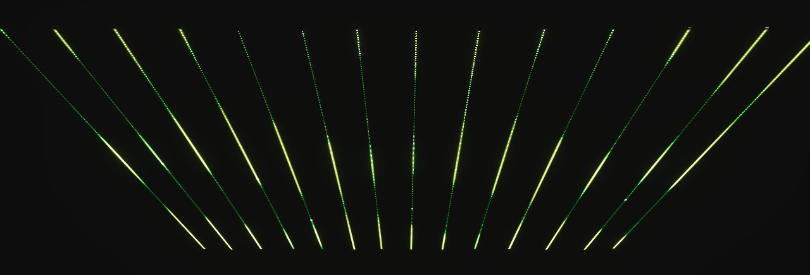 **Plaid**: two sets of broad stripes crossing at an angle, moving and slowly turning. |
| 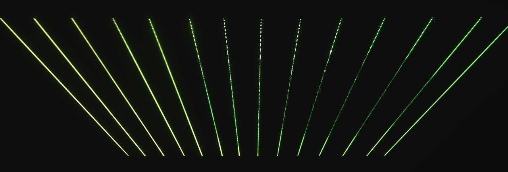 **Rings**: concentric rings flowing out of, or into, a slowly wandering centre. | 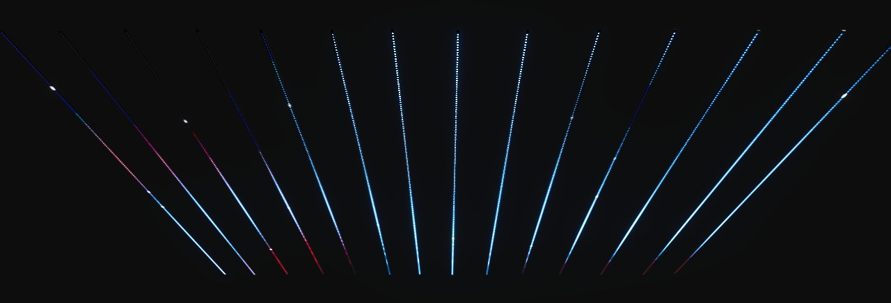 **Drops**: big rings spreading from where drops land (a point you set and can move with Motions, or random places) and fading out, like raindrops on a pond. |
| 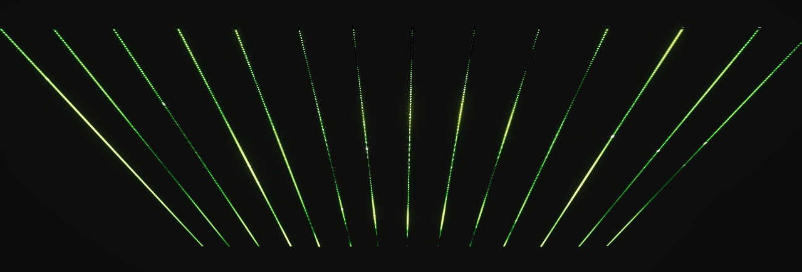 **Interference**: two sets of ring waves around centres that circle each other. | 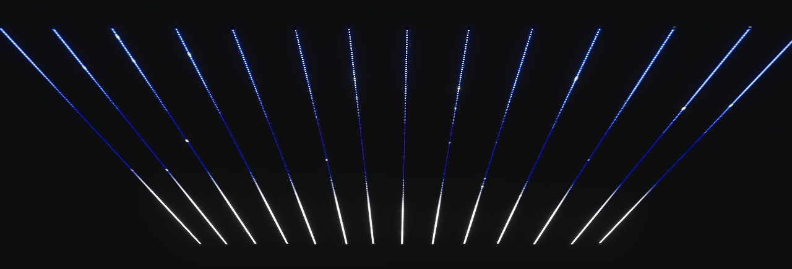 **Sparkle**: twinkles in palette colours, as an effect of its own or as an overlay on any other. |
| 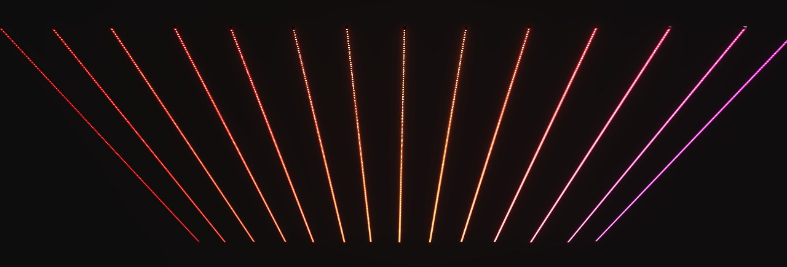 **Gradient**: a steady gradient through the palette, straight at any angle or round from a centre; Colour drift or a Motion on Colour offset makes the colours flow. | |

**Strobe** is a drum machine of flashes: each preset holds a grid of four lanes and 32 steps (two
bars of 1/16 notes on the beat, or a set number of steps a second), and on the steps set the lanes
flash the whole ceiling, a band, a block or a circle or square, somewhere new each time.

The scrolling effects have a position slider: **Offset** (Rolling bars, Plaid, Rings,
Interference), **Offset X** and **Offset Y** (Clouds), and Lighthouse has **Angle**. With the speed
at 0, a Motion on it moves the pattern back and forth.

## The web page

Open `http://beamled.local` (or the board's address). In config mode it is `http://192.168.4.1`
on the hotspot, and any address a phone tries leads to it.

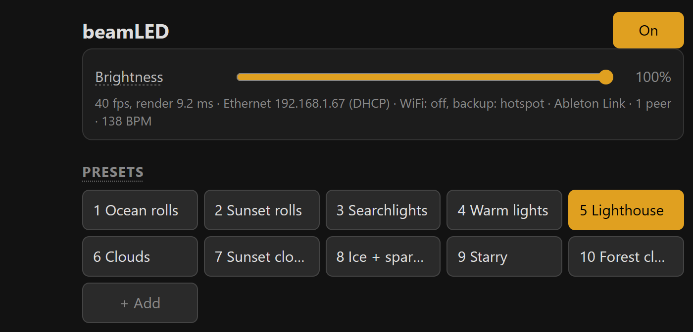

The Status card shows the frame rate and render time, the temperature, how long the board has run
and why it started, the network and Ableton Link, with a Restart button (tap twice). Click a
preset to play it; **+ Add** copies the one playing. A dot after a name marks changes that aren't
saved yet.

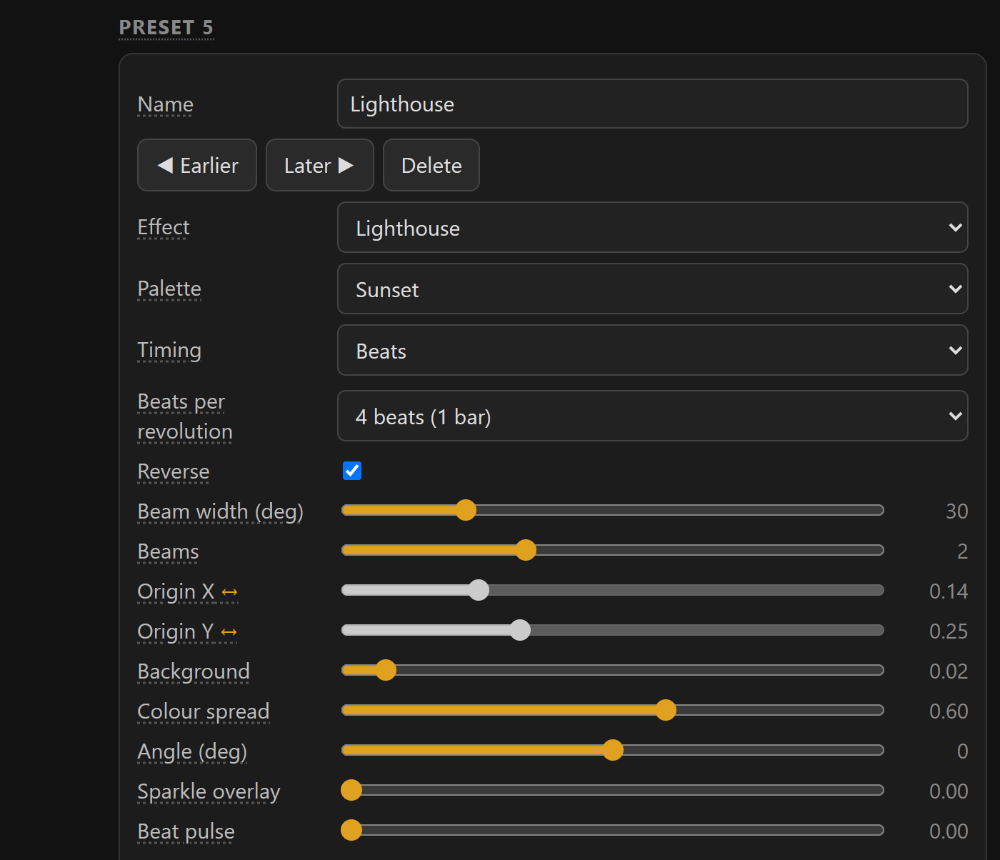

Each preset: its name, its place in the list (Earlier / Later / Delete), effect, palette, timing
and the effect's sliders. **Save** keeps the changes; after a rename it reads **Save as new** and adds\na preset with the new name, leaving the original as it was. A preset just added takes its first\nSave in place. Sliders reach the ceiling within a frame. A slider moved by a Motion
shows ↔ and follows it on screen.

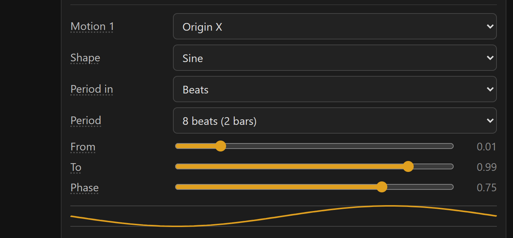

A **Motion** moves one slider between From and To. Shapes: Sine, Linear, Ease in-out, Hold at
ends, Overshoot, Bounce, Random slide (a new random value each half period, glided to), Min max (From,
then To, with no transition) and Random jump (Random slide's values, jumped to at once and held); the drawing shows one there-and-back. The period is in seconds or in
beats; in beats it keeps to the bar. Phase sets where in its cycle it starts, so motions can
run out of step. Motions run on the board, not in the browser: the page only shows them.

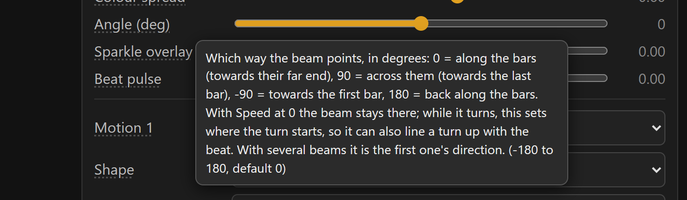

Every control has help: hover with a mouse, or on a touch screen tap its label (long-press a
button).

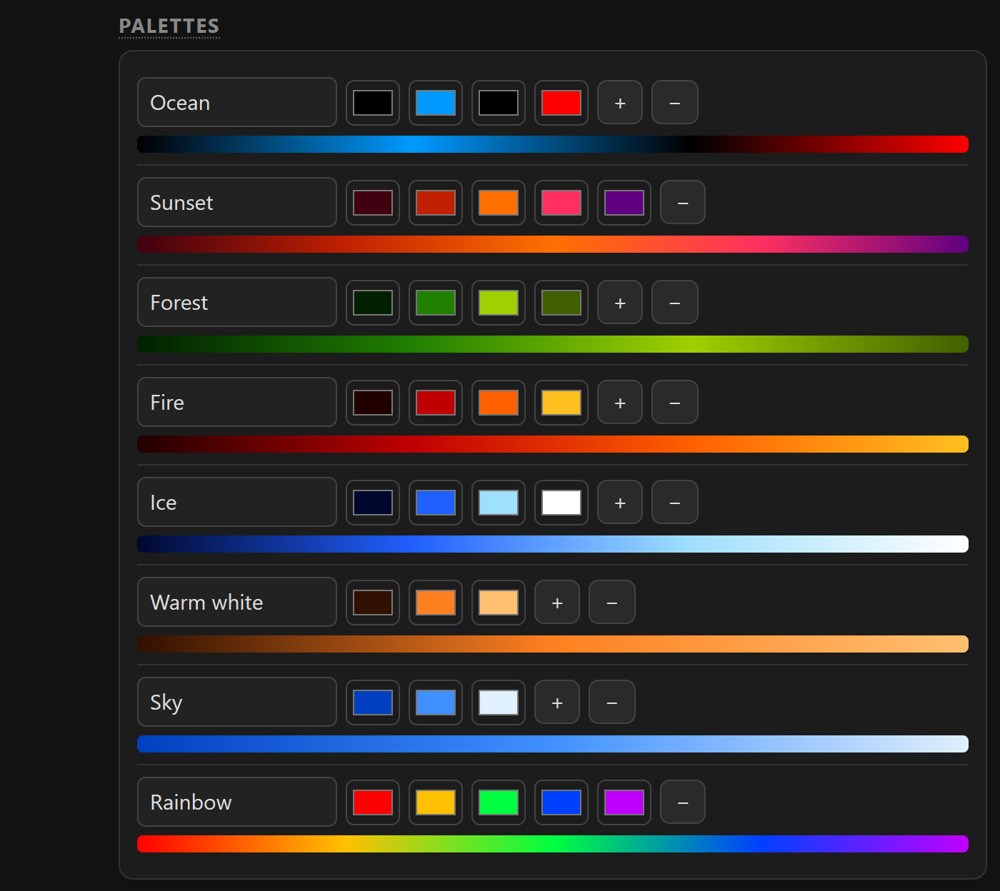

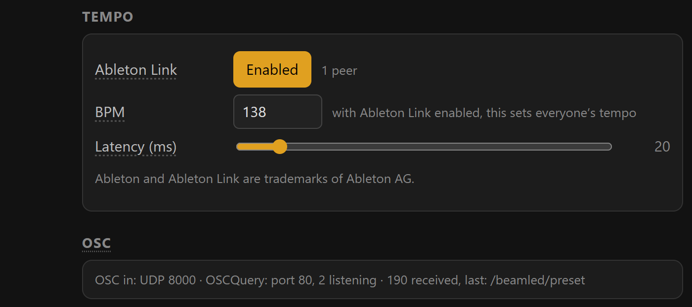

One page at a time: when beamLED is already open in another window or on another device, a new page
asks *Continue to use it here?* and the other one gets the same question back.

## Timing and Ableton Link

Ableton Link is **Enabled** or **Disabled** on the page. Enabled, the board joins the Link session
on its network (on site, the Live laptop joins the board's network); with no peers,
or disabled, it keeps its own tempo.

Per preset, **Timing**:

- **Time**: speeds in their own units (% of the ceiling's shorter side per second, rpm, degrees per second).
- **Time, follow tempo**: the set speed is the speed at 120 BPM and scales with the tempo.
- **Beats** (effects with a cycle): one band, revolution, sweep, stripe, ring, drop or wave takes 1,
  2, 4 ... 64 beats and lands on the bar. A change eases onto the new grid instead of jumping.

**Beat pulse** dips the brightness between beats, strongest on the bar's first beat. **Latency**
renders frames that much ahead, so beats land on time at the LEDs.

## OSC and OSCQuery

- OSC in: UDP port **8000**.
- OSCQuery: HTTP and WebSocket on port **80**, at `beamled.local:80`. It lists every address with its
  type, range, description and current value; a client that LISTENs to an address gets each change
  of it, as OSC bundles over the WebSocket. HOST_INFO points clients at port 8000.

In MIMa, add beamLED as an **OSCQuery** application at `beamled.local:80`. Its addresses can then be
browsed, sent to (a group's *Sends to* can name the OSCQuery application) and followed as feedback.

| Address | Type | |
|---|---|---|
| `/beamled/preset` | i | the preset playing, 1 = the first |
| `/beamled/next`, `/beamled/prev` | trigger | as a short press of the button |
| `/beamled/on` | T/F | on or off with a fade; no argument toggles |
| `/beamled/brightness` | f 0..1 | master brightness |
| `/beamled/effect_brightness`, `sparkle_brightness` | f 0..1 | the effect alone; how strongly the sparkle overlay's twinkles show (0 = not at all); both under the master brightness |
| `/beamled/link` | T/F | Ableton Link enabled |
| `/beamled/save` | trigger | saves every preset as it plays |
| `/beamled/palette` | i | palette lock: 0 each preset's own palette, k every preset plays palette k (not saved) |
| `/beamled/sparkle` | f 0..1 | the sparkle overlay, over every preset |
| `/beamled/sparkle_timing`, `sparkle_burst` | i 0..6, T/F | sparkle overlay: 0 free; twinkles start every 1 = 1, 2 = 1/2, 3 = 1/4, 4 = 1/8, 5 = 2, 6 = 4 beats; bursts or single twinkles |
| `/beamled/sparkle_colour` | i | sparkle overlay colours: 0 white, 1 the playing preset's palette, 1 + k palette k |
| `/beamled/sparkle_time` | f 0.2..5 | sparkle overlay: how long a twinkle lasts, in seconds (not with bursts) |
| `/beamled/sparkle_through` | T/F | sparkle overlay: each twinkle runs through its palette, first colour to last |
| `/beamled/sparkle_colour_step` | f 0..1 | sparkle overlay: 0 random colours, else each new twinkle this far along the palette from the one before |
| `/beamled/presets/<n>/play` | T/F | true while preset n plays; true plays it |
| `/beamled/presets/<n>/effect`, `palette` | i | by number, as on the page |
| `/beamled/presets/<n>/pulse` | f 0..1 | beat pulse |
| `/beamled/presets/<n>/mirror` | T/F | the right half mirrors the left |
| `/beamled/presets/<n>/timing`, `beats`, `reverse` | i, i, T/F | 0 time, 1 follow tempo, 2 beats; beats per cycle |
| `/beamled/presets/<n>/<slider>` | f or i | each slider of the preset's effect, named after it (`speed`, `band_width`, `angle`, `offset`, ...), in its own units |
| `/beamled/presets/<n>/motion1_target` ... `motion3_phase` | | each motion's `target`, `shape`, `from`, `to`, `seconds`, `beats` and `phase` |
| `/beamled/palettes/<k>/colours` | i 2..5 | how many colours |
| `/beamled/palettes/<k>/colour1` ... `colour5` | r | a colour (also `"#RRGGBB"` or three numbers) |
| `/beamled/palettes/<k>/midpoint1` ... | f | where the blend between two neighbouring colours is half-way, 0.5 = straight |
| `/beamled/palettes/<k>/position1` ... `position5` | f 0..1 | where that colour sits along the palette |

Preset changes over OSC play at once and, like changes on the page, are kept with Save
(`/beamled/save`). The tempo isn't on OSC: Ableton Link moves it by fractions of a BPM all the time.

## Hardware

- **Board**: WT32-ETH01 (ESP32, LAN8720 Ethernet, 4 MB flash).
- **Button**: GPIO4 to GND (internal pull-up). Short press: next preset, Auto off; double press: Auto on; long press: on/off. Held while
  the board powers up: config mode.
- **Output**: Art-Net to the pixel controller. Each row starts at its own universe and fills 170 RGB
  pixels per universe. By default row n (counting from 0) starts at universe 2n, so a row of up to
  340 LEDs fits; set the start universes on the page to match how the controller is patched.
- **Power**: the WT32-ETH01's 3.3 V regulator gets warm when it is fed 5 V; give it some air.

## Network

- **Ethernet with DHCP.** With no answer within 10 s the board takes a fallback address (default
  192.168.0.10/24; empty = automatic 169.254.x.x). A DHCP server that turns up
  within 2 minutes still wins.
- **No WiFi in normal running.** Hold the button while the board powers up for **config mode**: a
  hotspot named after the board with the web page at `http://192.168.4.1`, and nothing else (no
  Ethernet, no Art-Net, no Ableton Link). Restart from the page, or power it up again, to run.
- **Art-Net only over the cable.**
- `http://<name>.local` over mDNS; firmware updates over the network.

## Building and flashing

[PlatformIO](https://platformio.org), Arduino-ESP32 2.x.

```sh
# first flash, over the USB-serial adapter (IO0 to GND, then power up)
python -m platformio run -e wt32-eth01 -t upload

# afterwards, over the network
python -m platformio run -e ota -t upload
```

The partition table has two 1.9 MB application slots for updates over the network; changing it
needs a USB flash. The Ableton Link SDK is not part of this repository: `scripts/fetch_link.py`
fetches it into `.pio/deps/link` at build time.

## Layout

Set on the page under **Layout**: LEDs per row, rows, row length in metres, and either the
ceiling's measured row positions (`Measured rows`, 15 rows) or evenly spaced rows (`Row spacing`
in metres). Each row's start universe can be set, or filled in one after
another. The Art-Net destination and the gamma curve are under **Output**.

## How it works

- **Core 1, the render loop**, draws a frame every 25 ms (40 fps): the effect at each LED's position,
  the sparkle overlay, then gamma, brightness and fade in one table. It then hands the frame to the
  Art-Net task and moves on.
- **Core 0** has the network stack, Ableton Link, the Art-Net sender (30 packets per frame) and the
  HTTP server, which serves the page, its API and OSCQuery. API requests change settings under a
  lock the render loop also takes, and send their reply after letting go, so a slow network never
  holds up a frame.
- **Effects** avoid what the ESP32's FPU can't do in hardware (divide, square root, exp, trig) in
  their per-LED loops: tables with interpolation, reciprocals, and work moved out to once per row or
  per frame. On the board, at default settings, a frame takes 4 to 9 ms to draw (Rolling bars 4.0,
  Interference 9.0); `/api/bench?e=<effect>` measures it.
- **Settings** are kept in NVS. Edits to presets play at once but are only written on Save; other
  settings are saved a few seconds after the last change.

## HTTP API

The page uses these; they take and return JSON.

| | |
|---|---|
| `GET /api/state` | everything the page shows |
| `GET /api/effects?v=<build>` | the effects with their sliders and help (cached per firmware build) |
| `GET /api/status` | frame rate, network, Link, OSC |
| `POST /api/set` | brightness, gamma, Art-Net target, preset playing, on/off, `paletteLock` (-1 = off; not saved) |
| `POST /api/preset` | a preset's settings; `steps` (Strobe's pattern: four lanes, bit s = step s); `save`, `revert`; `{"motion": m, ...}` for a motion |
| `POST /api/presets` | `add`, `delete`, `move` |
| `POST /api/palettes` | `add`, `delete` |
| `POST /api/palette`, `/api/layout`, `/api/link`, `/api/net` | palettes, layout, Link, network |
| `POST /api/sparkle` | the sparkle overlay: `amount`, `beat`, `burst`, `colour`, `step` |
| `POST /api/auto` | Auto: `enabled`, `inBars`, `barsExp`, `seconds`, `shuffle` |
| `GET /api/bench?e=<effect>&frames=<n>` | render time of an effect, and free network sockets |

## Credits

- [FastLED](https://github.com/FastLED/FastLED) (MIT): noise and colour types.
- [ArduinoJson](https://arduinojson.org) (MIT).
- [Arduino-ESP32](https://github.com/espressif/arduino-esp32) and ESP-IDF.
- Ableton Link support uses the Link SDK, fetched at build time. Ableton and Ableton Link are
  trademarks of Ableton AG.

beamLED is part of [Beatline](https://beatline.xyz).
